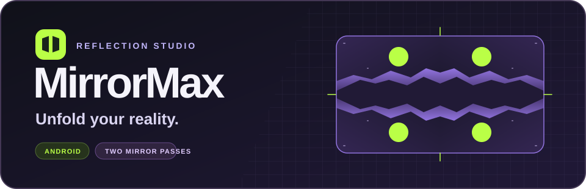
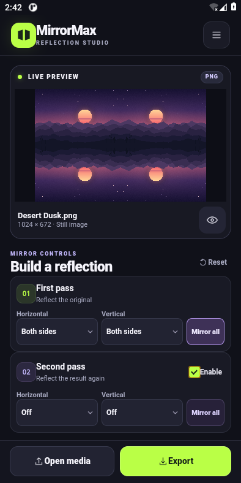
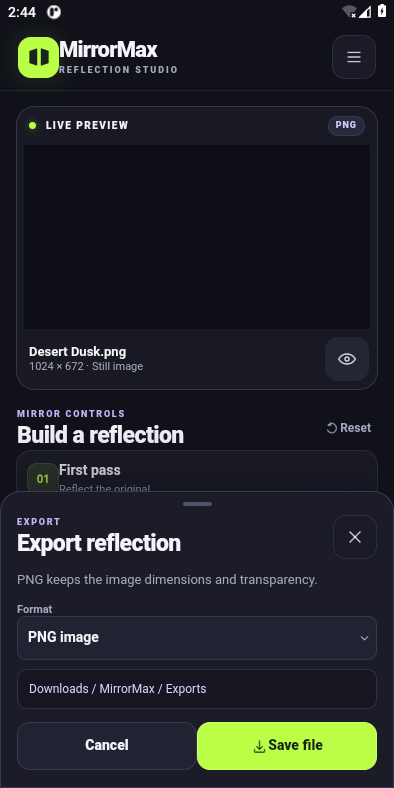

<p align="center">
  
</p>

<p align="center">
  <strong>Developed by the Background Gremlin Group</strong><br>
  <em>- Creating Unique Tools for Unique Individuals -</em>
</p>

<p align="center">
  <a href="https://github.com/bggg-gizmo/mirrormax/raw/refs/heads/main/dist/mirrormax.apk"><strong>↓ Download APK</strong></a>
  &nbsp;·&nbsp; <a href="dist/SHA256SUMS">SHA-256</a>
  &nbsp;·&nbsp; <a href="CHANGELOG.md">Changelog</a>
  &nbsp;·&nbsp; <a href="docs/BUILDING.md">Build from source</a>
</p>

# MirrorMax

**One reflection leads to another.** Mirror an image, GIF, or video from either side, then run a second pass on the result. The whole editor stays on one screen, with a live preview, a quick original comparison, and exports right on your device.

<p align="center">
  
  &nbsp;
  
  <br>
  <sub>MirrorMax 1.0.1 running on an Android 11 emulator.</sub>
</p>

## Make a reflection

1. Tap **Open media**, or choose **Try a sample** in the studio menu to load *Desert Dusk*.
2. In **First pass**, choose the horizontal and vertical directions. Pick **Mirror all** to reflect both axes at once.
3. Enable **Second pass** to reflect the result again. Tap the eye to compare with the original. Video and animated GIF previews loop in the editor.
4. Tap **Export**, choose a format, then **Save file**. Find the result under **Downloads → MirrorMax → Exports**, or use **Exports** in the app menu to open or share it.

| Open | Export |
| --- | --- |
| Still image | PNG or H.264 MP4 |
| Animated GIF | Animated GIF or H.264 MP4 |
| MP4 or MOV | H.264 MP4, with or without source audio |

A directional mirror keeps the named half and reflects it into the opposite half. **Both sides** fits the full source into each half and flips one copy. The second pass uses the first pass as its input. Reflections fill the output frame without added gaps or borders, and the preview adapts to portrait and landscape. Video input depends on the codecs available on your device. MP4 files play once in standard players unless the player enables repeat.

## Install the release

**Version 1.0.1 · Android 10+ · No network permission.** Download and open the standalone APK on your Android device. You don't need an SDK, Gradle, or a PC to install it.

| Release file | Verification |
| --- | --- |
| [mirrormax.apk](https://github.com/bggg-gizmo/mirrormax/raw/refs/heads/main/dist/mirrormax.apk) | [SHA256SUMS](dist/SHA256SUMS) |

```text
2cb1e5188bb5ce4951ea769b95dca3cd69592156f2afeb8129a35d38d62f1dd3
```

From the folder containing the download and checksum file, run `sha256sum -c SHA256SUMS`. On Windows, run `Get-FileHash .\mirrormax.apk -Algorithm SHA256` in PowerShell.

<details>
<summary>Updating from an earlier build</summary>

This release uses the same signing certificate as the rebuilt 1.0.0 APK. The first 1.0.0 build used a different key. If Android reports a signature conflict, back up any media you want to keep before uninstalling the older build and installing this one.

</details>

## Built without Gradle

The APK is built directly with Java, AAPT2, D8, zipalign, and apksigner. Android's media codecs handle H.264 and AAC, OpenGL ES renders the reflections, and the app's editor assets are bundled locally.

- [Build and signing guide](docs/BUILDING.md)
- [Architecture and file layout](docs/ARCHITECTURE.md)
- [Android test harness](test/android/README.md) and [release verification](docs/VERIFICATION.md)
- [Changelog](CHANGELOG.md) and [coordination log](COORDINATION.md)

<br>
<p align="center"><strong>Background Gremlin Group</strong> · <em>Creating Unique Tools for Unique Individuals</em></p>
